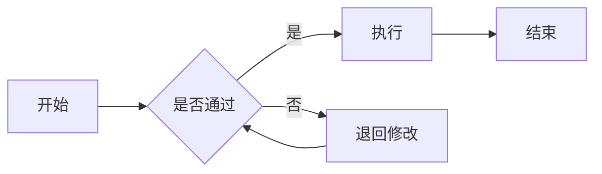
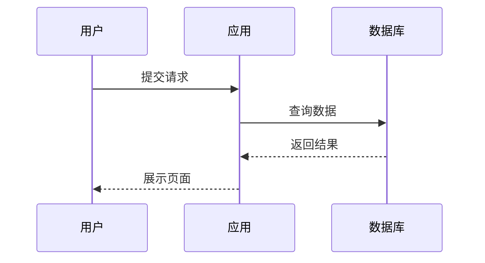
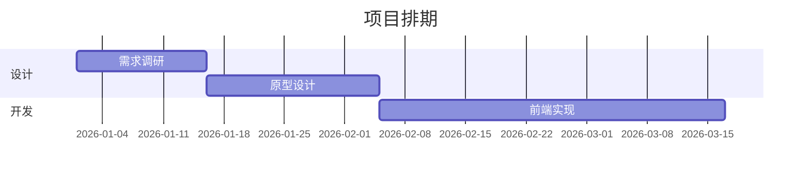

# Typora 精简渲染测试集

> **测前必做**：Typora 的一半语法藏在开关后面。打开 **偏好设置 → Markdown → 扩展语法**，把内联公式、下标、上标、高亮、图表、脚注、`[TOC]`、自动链接、Emoji 全部勾上。
> 没开开关就测，会误判成「Typora 不支持」，这是最常见的乌龙。

---

## 0. 测试前提

| 项 | 说明 |
| --- | --- |
| **扩展语法开关** | 偏好设置 → Markdown → 扩展语法，全勾 |
| **两个视图** | 实时预览（默认）与源码模式（`Cmd/Ctrl + /`）各看一遍，切换后渲染不应跳变 |
| **三个出口** | 编辑器内 → 导出 PDF → 导出 HTML，三处表现可能不同 |
| **主题** | 换一个默认主题（如 Github / Newsprint）再扫一眼，部分样式靠 CSS 实现 |

---

## 1. 核心语法（应 100% 通过）

### 1.1 标题 1–6 级

# 一级标题
## 二级标题
### 三级标题
#### 四级标题
##### 五级标题
###### 六级标题

> 语法：`#` + 空格 ｜ 快捷键 `Cmd/Ctrl + 1~6`
> 检查：6 级用完后再按 `Cmd+6` 是否无变化；大纲面板（`Cmd+Shift+1`）层级是否正确

### 1.2 行内样式

**加粗** ｜ *斜体* ｜ ***加粗斜体*** ｜ ~~删除线~~ ｜ ==高亮== ｜ `行内代码`

下划线用 HTML：<u>这是下划线</u>

嵌套：**加粗里有*斜体*和`代码`**，*斜体里有**加粗***。

中文连排：这是**加粗中文**和*斜体中文*以及`中文代码`紧贴文字的效果。

> 语法：`**x**`、`*x*`、`~~x~~`、`==x==`、`<u>x</u>`
> 检查：`==高亮==` 需要开关，关闭时显示两个字面等号；中文加粗斜体是否正常（Typora 官方明确支持 CJK）

### 1.3 上标与下标 ⚠️ 重点

水分子 H~2~O，硫酸根 SO~4~^2-^，质能方程 E = mc^2^，复杂下标 X~long text~。

> 语法：`~下标~`（**单**波浪号）、`^上标^`
> **关键**：Typora 的 `~x~` 是**下标**，飞书的 `~x~` 是**下划线**。同一份文件，两边显示完全不同——这是双平台迁移的头号坑。详见第 4 节。

### 1.4 列表

1. 有序第一项
2. 有序第二项
3. 有序第三项

- 无序第一项
- 无序第二项
  - 嵌套第二层
    - 嵌套第三层

- [x] 已完成任务
- [ ] 未完成任务

> 语法：`1.` / `-` / `- [ ]` ｜ 缩进用 `Tab`，反缩进 `Shift + Tab`
> 检查：任务列表勾选框是否可点击并同步改源码；有序列表插入新行后编号是否自动续

### 1.5 引用

> 这是一段引用。
> 可以连续多行，也可以包含 **加粗** 与 `代码`。

> 第一层
>
> > 第二层嵌套引用
> >
> > > 第三层

> 检查：三层嵌套的左侧竖线是否清晰；引用内放列表/代码块是否撑破缩进

### 1.6 代码块

行内：`npm run dev`

```javascript
// 检查语法高亮与行号
const greet = (name) => `Hello, ${name}!`;
console.log(greet("Typora"));
```

```python
def fib(n: int) -> list[int]:
    seq = [0, 1]
    while len(seq) < n:
        seq.append(seq[-1] + seq[-2])
    return seq[:n]
```

```diff
- 删除的行
+ 新增的行
  未变动的行
```

> 检查：语言标记是否被识别（Typora 支持约 100 种）；偏好设置里开启行号后是否显示；代码块能否一键复制

### 1.7 表格

| 姓名 | 职位 | 城市 |
| --- | --- | --- |
| 张三 | 前端 | 杭州 |
| 李四 | 后端 | 成都 |

| 左对齐 | 居中 | 右对齐 |
| :--- | :---: | ---: |
| A | B | C |
| 1 | 2 | 3 |

| 单元格内换行 | 说明 |
| --- | --- |
| 第一行<br>第二行 | 用 `<br>` 实现 |
| `代码` / **加粗** | 行内样式 |

> 检查：`:---:` 对齐是否生效；拖拽列宽后源码是否被改写；单元格内能否直接换行（Typora 需用 `<br>`）

### 1.8 链接

行内：[Typora 官网](https://typora.io "悬停标题")

自动链接：<https://support.typora.io>

引用式：[引用式链接][ref]，再引用一次[ref]。

页内跳转：[跳到第四节](#4-typora--飞书-冲突对照)

> 语法：`[文字](url "title")`、`[文字][ref]`
> 检查：`Cmd/Ctrl + 点击` 是否打开浏览器；引用式链接在文末定义是否生效；页内锚点能否跳转

### 1.9 图片

远程图片：


内嵌 SVG（不依赖网络）：


HTML 控制尺寸：


> 检查：拖拽图片能否缩放并改写源码；相对路径图片在移动文件后是否失效（Typora 有专门设置）；导出 HTML 后图片是内嵌还是外链

### 1.10 脚注

带脚注的句子[^1]，第二处引用[^1]，命名脚注[^note]。

[^1]: 这里是脚注内容，可以包含 **格式**。
[^note]: 命名脚注，用名称而非数字标识。

> 检查：悬停脚注标记是否浮出提示；导出 PDF 后脚注是否落在页脚

### 1.11 分隔线

---

***

> 语法：`---` 或 `***` 或 `___`
> 注意：`---` 紧跟文字下方时会被优先识别为「二级标题下划线」，前面必须有空行

---

## 2. Typora 招牌能力（其他编辑器常缺）

### 2.1 数学公式

行内：质能方程 $E = mc^2$，求根公式 $x = \dfrac{-b \pm \sqrt{b^2-4ac}}{2a}$。

块级：

$$
\int_{-\infty}^{\infty} e^{-x^2}\,dx = \sqrt{\pi}
$$

矩阵与多行：

$$
\begin{aligned}
\nabla \cdot \mathbf{E} &= \frac{\rho}{\varepsilon_0} \\
\nabla \times \mathbf{B} &= \mu_0 \mathbf{J} + \mu_0 \varepsilon_0 \frac{\partial \mathbf{E}}{\partial t}
\end{aligned}
$$

> 语法：行内 `$x$`、块级 `$$...$$` ｜ 快捷键 `Cmd/Ctrl + Shift + M`
> **对比飞书**：飞书官方只列了 `$$`，Typora 行内 `$x$` 是原生支持
> 检查：开启「自动编号公式」后块级公式是否带序号；`$` 后按 ESC 是否弹出预览提示

### 2.2 化学方程式（mhchem）

$$
\ce{SO4^2- + Ba^2+ -> BaSO4 v}
$$

> Typora 内置 mhchem 扩展，多数编辑器没有这个能力

### 2.3 Mermaid 图表







> 检查：三种图是否都渲染；图能否右键导出为图片；语法错误时是否给出提示而非白屏

### 2.4 flowchart.js 与 sequence

```flow
st=>start: 开始
op=>operation: 处理数据
cond=>condition: 判断成功?
e=>end: 结束
st->op->cond
cond(yes)->e
cond(no)->op
```

```sequence
Alice->Bob: 你好
Note right of Bob: 思考中
Bob-->Alice: 收到
```

> 语法：```` ```flow ````、```` ```sequence ```` ｜ 注意这是 flowchart.js / js-sequence，不是 Mermaid，语法不通

### 2.5 目录

`[TOC]` 单独一行即可生成目录（本文件未放，避免与其他测试项冲突）。

> 检查：`[TOC]` 是否列出本文所有标题；导出 PDF 后目录是否带页码链接；源码模式下 `[TOC]` 是保留还是展开

### 2.6 YAML Front Matter

必须放在**文件第 1 行**才生效。示例（此为代码块，复制到新文件开头测试）：

```yaml
---
title: 测试文档
author: 你的名字
date: 2026-11-23
tags:
  - markdown
  - typora
---
```

> 检查：元信息是否不显示在正文；导出时是否被当作模板变量（配合自定义主题）

### 2.7 Emoji

短代码：`:smile:` `:rocket:` `:white_check_mark:` `:warning:`

直接输入：😀 🚀 ✅ ⚠️（`Ctrl + Cmd + 空格` 调起系统表情面板）

### 2.8 HTML 内联与嵌入

这是 <span style="color:#e5484d;font-weight:600;">红色加粗文字</span>，这是 <mark>mark 标签</mark>。

<details>
<summary>点击展开折叠内容</summary>

折叠区内的 Markdown **通常会被解析**（Typora 用内置 HTML 渲染，这点比飞书宽松）。

</details>

> 检查：`style` 属性是否生效；`<details>` 是否可点击展开；导出 HTML 后内联样式是否保留

---

## 3. 待确认项（官方文档未列 / 版本差异）

逐项记录，不要预设结论。

| 项目 | 语法 | 预期 | 实测 |
| --- | --- | --- | --- |
| GitHub 警告块 | `> [!NOTE]` | 官方文档未列 | |
| 定义列表 | `术语` + 换行 + `: 定义` | Markdown Extra 特性，未确认 | |
| Obsidian 下划线 | `++文字++` | 预期不识别 | |
| Emoji 短代码全量 | `:任意名称:` | 依赖内置表 | |
| iframe 嵌入 | `<iframe src>` | 官方支持嵌入 | |
| 视频标签 | `<video>` | 官方支持 | |
| 任务列表嵌套 | 缩进的 `- [ ]` | 预期支持 | |

> 说明：Typora 的支持范围随版本变化，以你本机版本实测为准，别照抄网上教程。

---

## 4. Typora ↔ 飞书 冲突对照

同一份 `.md` 在两边打开，结果不同的地方。**这一节决定文件能不能两边通用。**

| 语法 | Typora | 飞书 | 冲突级别 |
| --- | --- | --- | --- |
| `~文字~` | **下标** H~2~O | **下划线** | 🔴 高，语义完全不同 |
| `~~文字~~` | 删除线 | 删除线 | 🟢 一致 |
| `^文字^` | 上标 | 不支持 | 🟡 单向丢失 |
| `==文字==` | 高亮 | 不支持 | 🟡 单向丢失 |
| `$x^2$` 行内公式 | 支持 | 官方未列 | 🟡 单向丢失 |
| `$$x$$` 块级公式 | 支持 | 支持 | 🟢 一致 |
| `#######` 七级标题 | 字面文本 | 七级标题 | 🟡 飞书独有 |
| `[TOC]` | 支持 | 不支持 | 🟡 单向 |
| `[^1]` 脚注 | 支持 | 不支持 | 🟡 单向 |
| Mermaid | 支持 | 不支持（需画板） | 🟡 单向 |
| `<details>` | 支持 | 不支持（需折叠块） | 🟡 单向 |
| 表格对齐 `:---:` | 支持 | 需手动设 | 🟡 样式丢失 |

**三条实用结论：**

1. **`~x~` 必须改造**。想两边都正常，就别用单波浪号——下标改用 HTML `<sub>`，下划线改用 `<u>`，虽然丑但两边都认。
2. **公式统一写块级 `$$...$$`**，别用行内 `$x$`，飞书不认行内。
3. **标题不超过 6 级**，图表和折叠块到飞书后一律手工重建。

---

## 5. 导出校验（Typora 独有环节）

渲染对了不等于导出对了。导出后逐项对照：

| 出口 | 重点检查 |
| --- | --- |
| **PDF** | 公式是否变图片/乱码、Mermaid 是否保留、代码高亮是否丢失、脚注是否落到页脚、目录书签是否可跳转 |
| **HTML** | 样式是内联还是外链 CSS、图片是内嵌 base64 还是相对路径（发给别人会不会白图） |
| **Word (.docx)** | 表格边框是否保留、公式是否转为图片、代码块是否变成纯文本 |
| **图片 (PNG)** | 长文档是否被截断、是否按页切分 |

> 最常出问题的是 **PDF 里的 Mermaid 和公式**，以及 **HTML 导出后图片路径失效**。

---

## 6. 检查记录表

| # | 项目 | 预览 | 源码 | 导出PDF | 备注 |
| ---: | --- | :---: | :---: | :---: | --- |
| 1 | 标题 1–6 级 |  |  |  |  |
| 2 | 加粗 / 斜体 / 嵌套 |  |  |  |  |
| 3 | 删除线 `~~x~~` |  |  |  |  |
| 4 | 高亮 `==x==` |  |  |  | 需开关 |
| 5 | 下划线 `<u>` |  |  |  |  |
| 6 | 下标 `~x~` |  |  |  | 与飞书冲突 |
| 7 | 上标 `^x^` |  |  |  | 需开关 |
| 8 | 有序 / 无序列表 |  |  |  |  |
| 9 | 任务列表可点击 |  |  |  |  |
| 10 | 三层嵌套引用 |  |  |  |  |
| 11 | 代码块高亮 + 行号 |  |  |  |  |
| 12 | 表格对齐 |  |  |  |  |
| 13 | 单元格 `<br>` 换行 |  |  |  |  |
| 14 | 链接 / 引用式链接 |  |  |  |  |
| 15 | 页内锚点跳转 |  |  |  |  |
| 16 | 图片（远程 / data URI / 缩放） |  |  |  |  |
| 17 | 脚注悬停与页脚 |  |  |  |  |
| 18 | 行内公式 `$x$` |  |  |  | 需开关 |
| 19 | 块级公式 `$$` |  |  |  |  |
| 20 | 公式自动编号 |  |  |  | 需开关 |
| 21 | 化学式 mhchem |  |  |  |  |
| 22 | Mermaid 流程图 |  |  |  |  |
| 23 | Mermaid 时序图 |  |  |  |  |
| 24 | Mermaid 甘特图 |  |  |  |  |
| 25 | flowchart.js |  |  |  |  |
| 26 | `[TOC]` 目录 |  |  |  |  |
| 27 | YAML Front Matter |  |  |  | 需放首行 |
| 28 | Emoji 短代码 |  |  |  |  |
| 29 | HTML 内联 style |  |  |  |  |
| 30 | `<details>` 折叠 |  |  |  |  |

---

## 附：常用快捷键

| 操作 | macOS | Windows |
| --- | --- | --- |
| 标题 1–6 | `Cmd + 1~6` | `Ctrl + 1~6` |
| 加粗 / 斜体 | `Cmd + B` / `Cmd + I` | `Ctrl + B` / `Ctrl + I` |
| 删除线 | `Cmd + Shift + D` | `Ctrl + Shift + D` |
| 行内代码 | `` Cmd + ` `` | `` Ctrl + ` `` |
| 代码块 | `Cmd + Shift + K` | `Ctrl + Shift + K` |
| 公式块 | `Cmd + Shift + M` | `Ctrl + Shift + M` |
| 表格 | `Cmd + T` | `Ctrl + T` |
| 链接 | `Cmd + K` | `Ctrl + K` |
| 源码模式切换 | `Cmd + /` | `Ctrl + /` |
| 大纲面板 | `Cmd + Shift + 1` | `Ctrl + Shift + 1` |

---

[ref]: https://support.typora.io "Typora 帮助中心"
